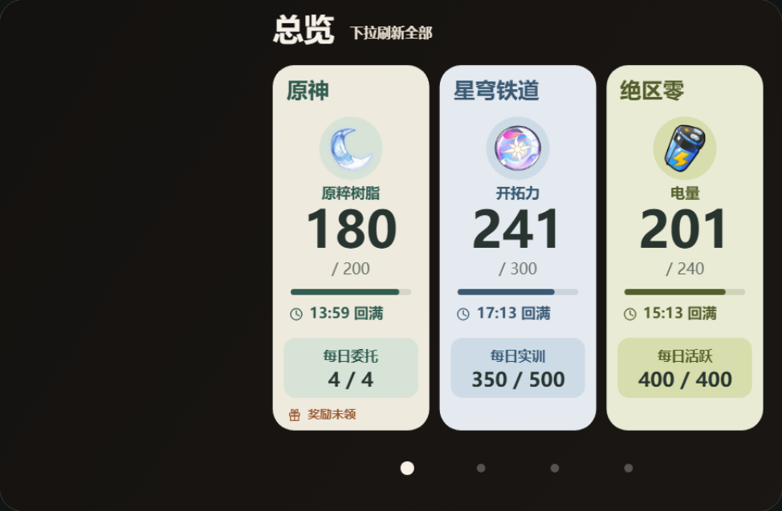

# 米游社背屏卡片

适用于 Rear Card Bridge API 2 的米游社卡片模块，支持原神、崩坏：星穹铁道和绝区零。模块包含四页卡片、米游社扫码设置页和后台便笺刷新，可导入 ZIP 使用，运行时无需电脑或本地服务。

当前版本：**0.1.3**。作者：[finall1008](https://github.com/finall1008)。模块 ID：`dev.finall.hoyolab`，`versionCode`：`4`。

## 安装与使用

1. 从 [Releases](https://github.com/finall1008/rear-card-hoyolab/releases) 获取 `rear-card-hoyolab-0.1.3.zip`，在支持 API 2 的卡片桥中导入模块。
2. 打开模块设置页，用国服米游社 App 扫码并确认登录。页面分别显示扫码、Token、Cookie、设备指纹和角色读取结果；中间步骤失败时可继续认证。
3. 选择需要绑定的游戏角色，保存后查询便笺，并将卡片应用到背屏。
4. 按需在卡片桥中启用后台刷新、设置模块刷新间隔；默认间隔为 15 分钟，实际执行受宿主和系统调度影响。

首页并列显示三款游戏的体力、回满时间和每日进度。详情左侧显示体力与每日进度，右侧显示最多六项便笺。仅体力使用游戏图标，刷新转圈显示在「正在刷新」文字旁。

- 点击游戏卡片或左右滑动进入详情，轻点底部页码点切换页面。
- 首页下拉刷新全部游戏，详情页下拉只刷新当前游戏。
- 委托、实训和活跃度按响应显示，奖励领取状态单独处理。
- 刷新失败保留对应账号和角色的缓存并显示错误；未知值显示「—」。

以下截图使用示例数据。



详细布局、数据规则和交互说明见 [卡片说明](CARD.md)。

## 账号与数据

支持单账号、国服米游社 App 扫码登录。完整便笺接口失败且满足上游条件时使用 widget 接口；该接口跟随米游社默认角色，不能强制查询设置中选定的 UID。设置页显示实际数据来源，卡片不显示 widget 来源的昵称或 UID，也不显示默认角色提示。

模块通过 `bridge.net`、`bridge.storage` 和 `bridge.card` 访问接口、保存账号和发布快照。凭据保存在模块私有存储，不包含在展示快照或发布包中。移除本地账号会清理本地认证和便笺，不等于撤销米游社端授权。

支持范围不包含国际服、短信或密码登录、自动签到及验证码求解。官方接口的风控和网络错误按实际结果返回。

## 从源码构建

完整构建需要 Node.js 22.x（22.18.0 起）或 Node.js 24.11.0 及以上，以及可执行的 `tar`。

```sh
npm ci
npm --prefix tools/card-build ci
node scripts/build-home-assets.mjs
npm run build:bridge
node scripts/build-module.mjs
node tools/card-build/bin/card-build.js dist/module dist/rear-card-hoyolab-0.1.3.zip
```

产物为 `dist/rear-card-hoyolab-0.1.3.zip`。ZIP 根目录包含 `module.json`、`card/`、`webroot/` 和 `background/`；脚本、运行依赖和体力图片均内置。`bridge-shim.js` 由宿主注入，包内设置页提供对应源码下载。

构建结构和宿主契约见 [API 2 模块说明](BRIDGE.md)，绘制入口见 [card/README.md](card/README.md)。

## 本地开发

```sh
npm ci
npm start
```

设置页位于 `http://127.0.0.1:18766`。在另一个终端运行：

```sh
npm run preview:card
```

预览页位于 `http://127.0.0.1:18767`，使用本地设置服务保存的账号和便笺，与安装模块共用绘制代码。打开预览读取本地状态，手动刷新才请求游戏便笺。

本地开发数据位于 `.local/`，包含明文凭据和展示缓存，已被 Git 忽略。代码在支持 POSIX 权限的平台设置目录 `0700`、文件 `0600`；Windows 访问控制由操作系统 ACL 决定。此存储不提供额外加密。

## 验证

```sh
npm test
node --check card/card.js
node --check bridge/card-main.mjs
```

仓库测试覆盖协议、认证状态、存储、桥适配和预览接口。发布构建使用项目内的编译器处理卡片 async/await；浏览器可验证布局和指针交互。自动化检查不包含手机安装、真实米游社认证和背屏宿主验收。

## 许可与来源

协议实现基于 [The Latte Helper](https://github.com/pizza-studio/PizzaHelperUnited)，固定来源提交为 `29a063c4d906d9f02954ddf1f422e9a4d087aa59`。JavaScript 源码使用 AGPL-3.0-or-later，游戏图片版权归 miHoYo / HoYoverse 所有。项目与 Pizza Studio、米哈游均无官方隶属关系。

详见 [LICENSE](LICENSE)、[NOTICE](NOTICE) 和 [协议与来源说明](UPSTREAM.md)。
